# Resort Management System — Architecture and Delivery Plan

## Proposed repository architecture

```text
resort-management/
├─ resort-frontend/          # Next.js App Router, React, TypeScript, Tailwind
├─ resort-backend/           # NestJS REST API, validation, auth, Swagger
├─ docs/                     # Architecture, ER model, API and operations guides
├─ docker-compose.yml        # Local PostgreSQL and Redis
├─ .env.example              # Shared local service configuration
└─ .gitignore
```

The frontend and backend are independently deployable applications in one repository. The browser calls a versioned NestJS API at `/api/v1`; the backend owns authorization, pricing, booking rules, and payment verification. PostgreSQL is the source of truth. Redis/BullMQ handles expiring holds, reminders, and asynchronous notifications. Cloudinary and Razorpay are provider adapters configured by environment. A `Property` foreign key is carried through operational records so the single-property launch can add properties later.

### Business module boundaries

1. Customer website and accounts
2. Administration
3. Reception/front desk
4. Housekeeping and maintenance

Authentication, database, notification, audit, and payment integrations are shared infrastructure, not additional business modules.

## Database ER diagram

```mermaid
erDiagram
  PROPERTY ||--o{ USER : employs
  PROPERTY ||--o{ USER_ROLE : scopes
  PROPERTY ||--o{ GUEST_PROFILE : registers
  PROPERTY ||--o{ ROOM_TYPE : offers
  PROPERTY ||--o{ ROOM : contains
  PROPERTY ||--o{ AMENITY : configures
  PROPERTY ||--o{ CANCELLATION_POLICY : defines
  PROPERTY ||--o{ RATE_PLAN : offers
  PROPERTY ||--o{ PROMOTION : configures
  PROPERTY ||--o{ DAILY_RATE : prices
  PROPERTY ||--o{ ROOM_INVENTORY : tracks
  PROPERTY ||--o{ BOOKING_HOLD : scopes
  PROPERTY ||--o{ BOOKING : receives
  PROPERTY ||--o{ BOOKING_ITEM : scopes
  PROPERTY ||--o{ BOOKING_NIGHT : scopes
  PROPERTY ||--o{ ROOM_ASSIGNMENT : scopes
  PROPERTY ||--o{ CANCELLATION_REQUEST : scopes
  PROPERTY ||--o{ PAYMENT : scopes
  PROPERTY ||--o{ PAYMENT_WEBHOOK_EVENT : scopes
  PROPERTY ||--o{ REFUND : scopes
  PROPERTY ||--o{ INVOICE : scopes
  PROPERTY ||--o{ HOUSEKEEPING_TASK : scopes
  PROPERTY ||--o{ MAINTENANCE_REQUEST : scopes
  PROPERTY ||--o{ NOTIFICATION : scopes
  PROPERTY ||--o{ AUDIT_LOG : scopes
  USER ||--o{ USER_ROLE : assigned
  ROLE ||--o{ USER_ROLE : grants
  USER ||--o{ GUEST_PROFILE : has
  USER ||--o{ REFRESH_TOKEN : rotates
  USER ||--o{ PASSWORD_RESET_TOKEN : resets
  ROOM_TYPE ||--o{ ROOM : classifies
  ROOM_TYPE ||--o{ ROOM_TYPE_AMENITY : includes
  AMENITY ||--o{ ROOM_TYPE_AMENITY : describes
  ROOM_TYPE ||--o{ DAILY_RATE : priced
  RATE_PLAN ||--o{ DAILY_RATE : defines
  CANCELLATION_POLICY ||--o{ RATE_PLAN : governs
  ROOM_TYPE ||--o{ PROMOTION_ROOM_TYPE : eligible
  PROMOTION ||--o{ PROMOTION_ROOM_TYPE : applies
  PROMOTION ||--o{ BOOKING : redeemed
  ROOM_TYPE ||--o{ ROOM_INVENTORY : tracks
  USER ||--o{ BOOKING_HOLD : creates
  GUEST_PROFILE ||--o{ BOOKING_HOLD : identifies
  BOOKING_HOLD ||--o{ BOOKING_HOLD_ITEM : reserves
  ROOM_TYPE ||--o{ BOOKING_HOLD_ITEM : held
  USER ||--o{ BOOKING : books
  GUEST_PROFILE ||--o{ BOOKING : identifies
  BOOKING ||--|{ BOOKING_ITEM : contains
  ROOM_TYPE ||--o{ BOOKING_ITEM : category
  RATE_PLAN ||--o{ BOOKING_ITEM : uses
  BOOKING_ITEM ||--|{ BOOKING_NIGHT : snapshots
  BOOKING ||--o{ ROOM_ASSIGNMENT : allocates
  BOOKING_ITEM ||--o{ ROOM_ASSIGNMENT : fulfills
  ROOM ||--o{ ROOM_ASSIGNMENT : assigned
  BOOKING ||--o{ CANCELLATION_REQUEST : requested
  USER ||--o{ CANCELLATION_REQUEST : decides
  BOOKING ||--o{ PAYMENT : paid_by
  PAYMENT ||--o{ PAYMENT_WEBHOOK_EVENT : receives
  PAYMENT ||--o{ REFUND : refunded
  BOOKING ||--o| INVOICE : billed
  ROOM ||--o{ HOUSEKEEPING_TASK : cleaned
  USER ||--o{ HOUSEKEEPING_TASK : assigned
  USER ||--o{ HOUSEKEEPING_TASK : completes
  ROOM ||--o{ MAINTENANCE_REQUEST : serviced
  USER ||--o{ MAINTENANCE_REQUEST : assigned
  USER ||--o{ MAINTENANCE_REQUEST : completes
  USER ||--o{ NOTIFICATION : receives
  USER ||--o{ AUDIT_LOG : acts
```



The schema also contains explicit join rows for room amenities and promotion eligibility. Refresh tokens and password-reset tokens store token hashes. Payment webhook events have unique gateway event IDs. Booking items and nights preserve booked prices and policy snapshots. Check-in is inclusive and check-out is exclusive. Inventory counters have database checks; physical room assignments have a PostgreSQL exclusion constraint against overlapping active stays, and assignment foreign keys require the assigned room and booking item to share a room category.

## Phased implementation plan

| Phase | Outcome |
|---|---|
| 1. Initialization | Monorepo, Next.js and NestJS apps, environment templates, local PostgreSQL/Redis Compose, Git baseline, architecture docs |
| 2. Database | Normalized Prisma schema, migrations, ER model, safe environment-driven seed |
| 3. Authentication | Password hashing, access/refresh tokens, RBAC guards, protected routes |
| 4. Customer frontend | Resort pages, room discovery, availability search, account flows |
| 5. Administration | Dashboard, room/category/pricing/customer/staff management |
| 6. Booking engine | Availability, holds, transactional reservation, cancellation |
| 7. Payments | Razorpay orders/signatures/webhooks, idempotency, refunds/invoices |
| 8. Resort operations | Reception, allocation, check-in/out, housekeeping, maintenance |
| 9. Verification and deployment | Automated tests, security review, deployment, backup/recovery documentation |

Each phase is reported with changed files, run instructions, verification, and remaining work. The next phase begins after the current phase is reviewable and working.

## Phase 1 scope and affected files

Phase 1 established repository/app skeletons, local dependency orchestration, configuration boundaries, and the architecture record. It did not implement authentication, booking, payments, or the business modules. The full database model was added in Phase 2.

## Phase 2 database implementation

Implemented in `resort-backend/prisma/schema.prisma`, `resort-backend/prisma/migrations/`, `resort-backend/prisma/seed.ts`, and `resort-backend/src/database/`. The schema is validated and the client is generated into `resort-backend/src/generated/prisma/` (ignored; regenerate with `npm run prisma:generate`). The initial migration is generated from an empty PostgreSQL model and includes range, amount, capacity, inventory-counter, matching-room-category, and overlapping-room constraints. The seed creates a development property, roles, room categories, amenities, sample physical rooms, one room-only rate plan, and 366 days of inventory. It requires the initial administrator email and a password of at least 8 characters through environment variables.

This environment does not have Docker or a local PostgreSQL client/server, so the migration has not been applied to a live database and the seed has not been executed. Applying the migration requires PostgreSQL with permission to enable the `btree_gist` extension.
